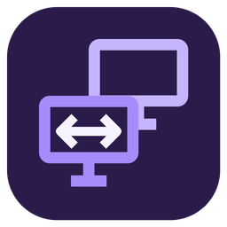

> [!CAUTION]
> **SINGLE CONTRIBUTOR ONLY.** Every commit must be authored by `PurpleIndustriesAI`
> (`329276754+PurpleIndustriesAI@users.noreply.github.com`). No other accounts, no
> `Co-Authored-By` / AI attribution lines. CI rejects violations. Read
> [CONTRIBUTING.md](CONTRIBUTING.md) before your first commit.

<p align="center"></p>

# Remote Access Core (Bridge)

Copy on one machine, paste on the other. Remote Access Core (Bridge) syncs **text, images, and files**
in both directions between your own Windows and Linux machines over your **LAN or Tailscale**,
with mutual TLS and certificate pinning. It also ships as a Crew app.

This app was called Remote Access Crew until 2026-10-24. Only shown names changed:
binaries, `~/.remote-access-crew`, and the `Downloads/Remote Access Crew` folder keep their names,
so existing pairings and received files stay where they are.

## What it does

| You copy... | The other machine gets... |
|---|---|
| Text | The same text on its clipboard |
| An image (screenshot, "Copy image") | A real image on its clipboard (CF_DIB on Windows, `image/png` on Linux) |
| Files or folders (Explorer/Dolphin "Copy") | The files saved to `Downloads/Remote Access Crew`, verified by SHA-256, and placed on its clipboard as files so Paste works in the file manager |

Sync is automatic for every paired device with **Sync** on. You can also send on demand from
the Crew page or with `rac send`.

## Install

Download the release for your platform and check it against `SHA256SUMS.txt`.

**Windows**

```powershell
powershell -ExecutionPolicy Bypass -File .\install.ps1
# Once, as administrator, so other machines can connect (LAN subnet and Tailscale only):
powershell -ExecutionPolicy Bypass -File .\install.ps1 -Firewall
```

This adds **Remote Access Core (Bridge)** to the Start Menu and to Startup, with its icon.

**Linux**

```sh
./install.sh
```

This installs to `~/.local/bin`, adds a launcher and an autostart entry, and prints `ufw`
commands if a firewall is active. Clipboard support: X11, KDE Plasma and wlroots Wayland
(data-control), and GNOME Wayland through XWayland.

## Pair two machines

1. On machine A: Crew page, **Show a pairing code**, or `rac pair-code`.
2. On machine B: **Enter a code** with A's LAN or Tailscale address, or
   `rac pair 192.168.1.20 ABCD-EFGH-JKLM-NPQR`.

The code is 80 random bits, valid for 15 minutes, single use, and locked after 5 wrong tries.

## Commands

```
rac status                      this machine, peers, recent transfers
rac pair-code / rac pair ADDR CODE
rac send [--to PEER] [--text TEXT | FILE...]   no input sends the current clipboard
rac ping PEER
rac sync on|off [--peer PEER]
rac unpair PEER
rac allow PEER clipboard|files on|off      grant or revoke one device's access
rac request-access PEER [clipboard] [files] ask PEER's owner for access
rac approve PEER | rac deny PEER            answer a pending request
rac access-requests on|off                  let paired devices ask this machine
rac mic on PEER [tone] / rac mic off        stream this PC's microphone to PEER (Windows, Linux)
```

## Access

Pairing proves identity only. Each machine must also allow a device's **Clipboard** (text and
images) and **Files** before anything is exchanged. On the device you want to use, choose
**Allow locally and ask for access** (or `rac request-access PEER`): that allows the exchange on your side and
asks the other owner, who sees a toast (through Crew's Notification Bridge when installed),
the request on the Crew page, and `rac status`. Approval lasts until revoked. Turn
**Allow access requests** off to refuse all requests; the per-device switches still work.

## Microphone

A client can stream its default microphone to a host while you use the host remotely (the RAC
Host's Sunshine core does not forward microphones). The host plays it into **Speakers (Steam Streaming Microphone)**,
so voice chat, games and Command Core on the host hear it on **Microphone (Steam Streaming
Microphone)**. Windows only; 48 kHz mono 16 bit PCM in 20 ms frames over the paired TLS link.

1. On the host: `rac allow CLIENT microphone on` (or approve the client's request). It is never
   granted back, and `rac allow CLIENT microphone off` ends a live stream at once.
2. On the client: `rac mic on HOST`. Windows shows its microphone indicator, `rac status`
   says MICROPHONE LIVE, and a toast appears when Crew is installed. `rac mic off` stops capture
   immediately. `rac mic on HOST tone` sends a 440 Hz test tone instead of your voice.

The host refuses to play when the two sides of the Steam device use different Default Formats,
because that driver copies bytes without converting and voice would come out slowed and broken.
Set **Speakers (Steam Streaming Microphone) > Properties > Advanced > Default Format** to the
format of the microphone side (usually 1 channel, 32 bit, 44100 Hz), and keep the microphone
side's level at 0 dB. It never falls back to the default speakers, which the RAC Host streams back.

### Linux hosts (0.7.1)

On Linux the host plays the client's microphone into a PipeWire loopback that apps see as
**RAC Client Microphone** (node `rac_client_mic`). The `rac-client-mic` user service creates it
(the RAC Linux installer enables it; by hand: `systemctl --user enable --now rac-client-mic`),
and the bridge starts it on demand if it is missing. Pick **RAC Client Microphone** as the input
in the app, or make it the default with `pactl set-default-source rac_client_mic`. A Linux client
captures its default PipeWire microphone with `pw-cat`. The Crew page's setup wizard has a
**Client microphone** step and each device in settings has a **Microphone** switch.


## Network helper

Streaming quality depends on the network more than anything else. The **Network** panel
(and the CLI) shows:

- **Live Wi-Fi:** signal, band, channel, standard, and link rate, refreshed every second
  with the **Live signal finder** on. A trend arrow and "best so far" help you find the
  strongest spot for a laptop or router.
- **Your network on each band:** every access point broadcasting your network, with signal
  and how busy its channel is, so you can see when 5 GHz is the better choice.
- **Advice:** plain fixes from the real readings (switch to 5 GHz, weak signal, busy
  channel, slow link, older Wi-Fi standard, use a cable).
- **Speed test:** two-way throughput, latency, and jitter to a paired device over the same
  encrypted link, with a suggested Moonlight video bitrate.

```
rac net              # readings and advice (works without the bridge)
rac net --watch      # live signal finder in the terminal
rac probe PEER       # latency and jitter
rac speedtest PEER   # throughput and suggested Moonlight bitrate
```

Readings come from `netsh` on Windows and `nmcli` on Linux. Nothing leaves the machine.

## Crew app

`crew-app/` is the Crew app (Control Room UI). The installers register it when Crew is
present. Crew requires the owner to trust third-party apps in Settings before they run.

### Crew session router

Version 0.6.0 can expose the open Crew sessions that a local router chat may address. Kimi and
Codex on a paired machine can page through that signed directory, choose an exact session,
send it a message, and read later replies. This uses the separate `crew-sessions` channel,
not the ordinary Crew Link mailbox.

On the receiving machine, enable the channel, approve **Files** and **Crew sessions** for
the peer, and choose the router chat and peer in the RAC app. The router chat must be an
open, persistent, eligible local chat. Its ordinary Crew session permissions still apply.
The Crew Link signing key and independently pinned peer public key must already be configured.

From the Crew app directory on the client machine:

```sh
python backend/session_client.py list --peer HOST --agent kimi --all
python backend/session_client.py send --peer HOST --agent kimi --target CHAT_KEY --text "Hello"
python backend/session_client.py read --peer HOST --agent kimi --target CHAT_KEY --since 0
```

Use `codex` as the agent for Codex. A send result says whether the turn started or queued.
Read with the returned `next_since` cursor. A timeout is not proof of delivery or failure;
do not retry the same request automatically.

The directory contains metadata only. Private, app scoped, unattended, channel linked,
mirrored, crew mode, remote executor, cross-workspace, and otherwise unauthorized sessions
are excluded. Message and reply bodies stay within the paired encrypted channel and use
Crew's existing redaction. The signature authenticates the paired machine. The agent label
identifies the requested caller but is not a separate per-agent identity.

## Build

```sh
cargo test                      # unit + three-node end-to-end test
cargo test --test clipboard_live -- --ignored --test-threads=1   # overwrites your clipboard
cargo build --release
```

## Status and limits (v0.1)

- Verified: Windows live clipboard in every direction (text, image, files), echo
  suppression, and password-manager exclusion. Linux: the same live test runs in CI under Xvfb.
- Not yet verified on two physical machines over Tailscale; see the release notes for the
  current field-test state.
- Linux cannot see password-manager "private" hints through the clipboard library, so on
  Linux turn Sync off for a peer if you copy secrets often.
- Empty folders and symbolic links are not sent.

See [SECURITY.md](SECURITY.md) for the threat model and
[docs/crew-mesh.md](docs/crew-mesh.md) for the self-hosted Tailscale plan.

Copyright (c) 2026 Purple Industries. All rights reserved.
